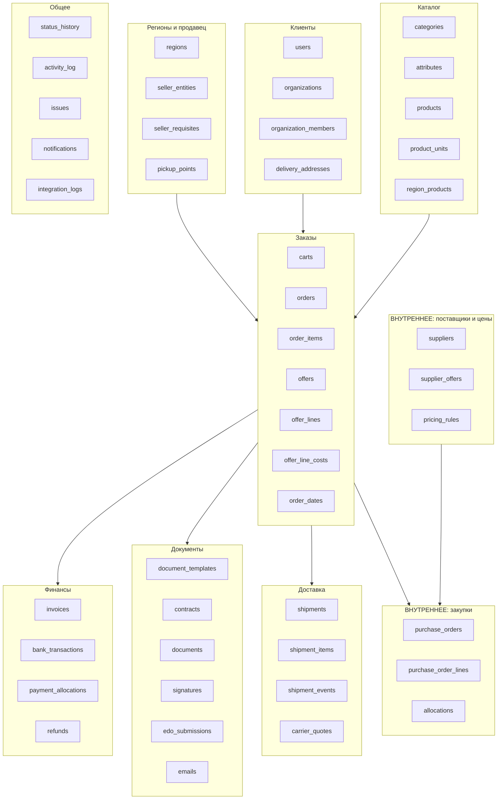
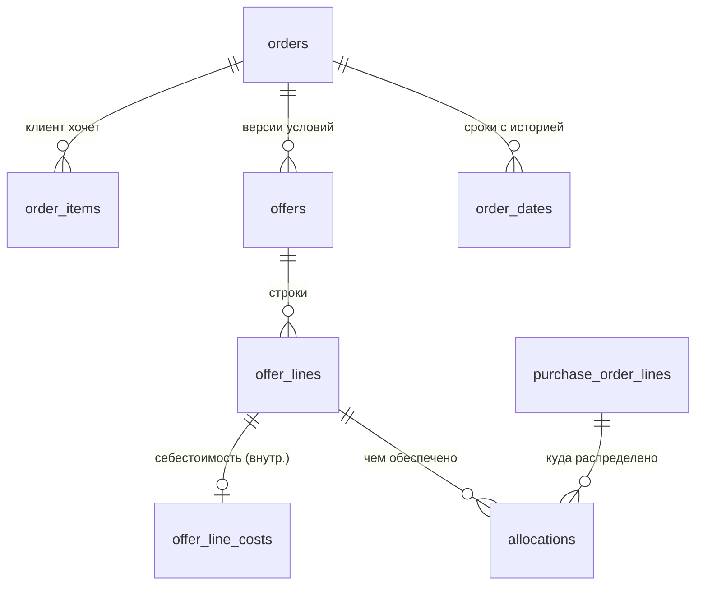
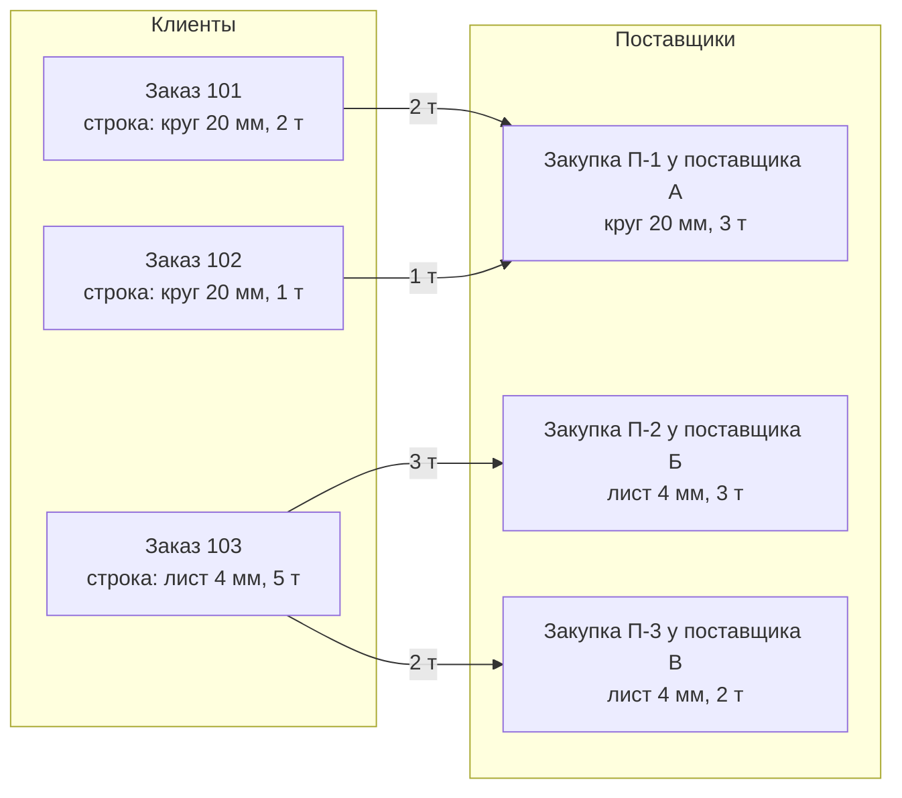

# 1. Схема базы данных

Статус: черновик на согласование · СУБД: PostgreSQL · ORM: Eloquent (Laravel).

## Как читать этот документ (простыми словами)

База данных — это набор **таблиц**, как листы в Excel. У каждой строки есть номер `id`. Таблицы ссылаются друг на друга по этим номерам: например, у строки заказа есть поле `order_id` — номер заказа, которому она принадлежит.

Колонка «Тип» нужна в основном ревьюеру. Вам достаточно колонки «Зачем».

Типы: `id` — номер, `fk → таблица` — ссылка на строку другой таблицы, `text` — строка, `money` — `numeric(15,2)`, `qty` — `numeric(15,4)`, `enum` — одно значение из списка, `json` — набор полей произвольной структуры, `ts` — дата и время, `date` — дата, `bool` — да/нет.

Во всех таблицах, кроме журналов, есть служебные поля `created_at` и `updated_at`. Ниже они не повторяются.

## Карта групп таблиц

Группы с пометкой **ВНУТРЕННЕЕ** клиентский API не читает никогда.

---

## A. Регионы и продавец

### `regions` — регионы (города)

| Поле | Тип | Зачем |
|---|---|---|
| id | id | |
| code | text, уникальный | Короткий код: `smr`, `msk`, `ekb`… Совпадает с поддоменом сайта, где возможно |
| name | text | «Самара» |
| timezone | text | `Europe/Samara`. Сроки и окна доставки считаются в местном времени |
| seller_entity_id | fk → seller_entities | Какое юрлицо продаёт в этом регионе (О-1) |
| ship_from_address | text | Город и адрес отправления по умолчанию для расчёта ТК |
| is_active | bool | Регион показывается в приложении, только когда данные готовы |
| sort | int | Порядок в списке |

### `seller_entities` — юрлица-продавцы

| Поле | Тип | Зачем |
|---|---|---|
| id | id | |
| name_short | text | «ООО «ГК «Стилкор»» |
| inn | text | Для поиска и проверки |
| is_active | bool | |

### `seller_requisites` — версии реквизитов продавца

Реквизиты выделены в отдельную таблицу с версиями, потому что они меняются (новый банк, новый директор). В документ попадает **утверждённая версия, действовавшая на дату документа**.

| Поле | Тип | Зачем |
|---|---|---|
| id | id | |
| seller_entity_id | fk → seller_entities | |
| version | int | 1, 2, 3… |
| name_full, name_short | text | |
| inn, kpp, ogrn, okpo | text | |
| legal_address, postal_address | text | |
| bank_name, bik, account, corr_account | text | Расчётный счёт |
| signer_name, signer_position, signer_basis | text | Кто подписывает и на каком основании (устав, доверенность №…) |
| vat_rate_default | numeric | Ставка НДС по умолчанию (О-5) |
| phone, email, website | text | |
| valid_from | date | С какой даты действует |
| status | enum: `draft`, `approved`, `archived` | **В документы попадают только `approved`** |
| approved_by | fk → staff_users | Кто утвердил |
| approved_at | ts | |

### `pickup_points` — пункты самовывоза и отгрузки

| Поле | Тип | Зачем |
|---|---|---|
| id | id | |
| region_id | fk → regions | |
| name, address | text | |
| lat, lng | numeric | Для карты |
| work_hours | text | |
| instructions | text | Как проехать, документы для получения |
| is_public | bool | Показывать ли клиенту. Склады поставщиков клиенту не показываются (О-18) |
| is_active | bool | |

---

## B. Клиенты

### `users` — пользователи мобильного приложения

| Поле | Тип | Зачем |
|---|---|---|
| id | id | |
| phone | text, уникальный | Вход по SMS-коду |
| email | text | Вход и письма |
| password | text (хеш) | Если вход по паролю |
| name | text | ФИО |
| phone_verified_at, email_verified_at | ts | |
| status | enum: `active`, `blocked` | |
| default_region_id | fk → regions | Выбранный город |
| pd_consent_at | ts | Когда дано согласие на обработку ПДн (152-ФЗ) |
| pd_consent_version | text | Версия текста согласия |

Сотрудники компании хранятся **отдельно**, в `staff_users` (раздел 3, роли). Это два разных входа: клиент не может попасть в админку, даже если узнает её адрес.

### `organizations` — организации-покупатели

| Поле | Тип | Зачем |
|---|---|---|
| id | id | |
| type | enum: `legal`, `ip`, `individual` | `individual` выключен в MVP (О-10) |
| name_full, name_short | text | |
| inn | text | Уникален в паре с kpp |
| kpp, ogrn | text | |
| legal_address, postal_address | text | |
| bank_name, bik, account, corr_account | text | Для договора и возвратов |
| signer_name, signer_position, signer_basis | text | Кто подписывает у клиента |
| source | enum: `dadata`, `manual` | Откуда реквизиты |
| external_snapshot | json | Ответ DaData целиком, на дату проверки |
| verification_status | enum: `unverified`, `verified`, `rejected` | Проверено ли менеджером. **Документы формируются только для `verified`** |
| verified_by, verified_at | fk, ts | |
| region_id | fk → regions | «Домашний» регион и ответственный менеджер |
| manager_id | fk → staff_users | Ответственный менеджер |
| payment_terms | enum: `prepay`, `deferral` | О-3 |
| deferral_days | int | Если отсрочка |
| credit_limit | money | Лимит задолженности при отсрочке |
| edo_operator, edo_box_id | text | Подключён ли клиент к ЭДО и его идентификатор у оператора |
| framework_contract_id | fk → contracts | Действующий рамочный договор, если есть (О-2) |
| internal_note | text | Заметка менеджера. **Клиенту не отдаётся** |

### `organization_members` — кто из пользователей работает от имени организации

| Поле | Тип | Зачем |
|---|---|---|
| id | id | |
| organization_id | fk → organizations | |
| user_id | fk → users | |
| role | enum: `owner`, `buyer`, `accountant`, `viewer` | Права внутри организации клиента (см. [роли](03-roli-i-prava.md)) |
| status | enum: `invited`, `active`, `removed` | |
| invited_by | fk → users | |

Один пользователь может состоять в **нескольких организациях**, а у одной организации может быть **несколько пользователей**.

### `delivery_addresses` — адреса доставки

| Поле | Тип | Зачем |
|---|---|---|
| id | id | |
| organization_id | fk → organizations | |
| label | text | «Стройка на Ново-Садовой» |
| address | text | Полный адрес |
| city | text | |
| fias_id | text | Код адреса (из подсказок адресов), нужен ТК |
| lat, lng | numeric | |
| contact_name, contact_phone | text | Кто принимает груз |
| access_notes | text | Подъезд для длинномера, манипулятор, время работы площадки |
| is_archived | bool | Удалённые адреса скрываются, но остаются в старых заказах |

---

## C. Каталог

### `categories` — категории

| Поле | Тип | Зачем |
|---|---|---|
| id | id | |
| parent_id | fk → categories | Дерево: «Сортовой прокат» → «Круг» → «Круг нержавеющий» |
| name, slug | text | |
| image | text | |
| sort | int | |
| is_published | bool | |

### `attributes` — справочник характеристик

| Поле | Тип | Зачем |
|---|---|---|
| id | id | |
| code | text, уникальный | `grade` (марка), `gost`, `diameter`, `thickness`, `width`, `length`, `wall`, `technology`, `form`… |
| name | text | «Марка стали» |
| type | enum: `number`, `text`, `enum` | |
| unit | text | `мм`, `м` |
| options | json | Варианты для `enum` |

### `category_attributes` — какие характеристики у категории

| Поле | Тип | Зачем |
|---|---|---|
| category_id | fk | |
| attribute_id | fk | |
| is_filterable | bool | Показывать в фильтрах |
| is_required | bool | |
| sort | int | |

### `products` — номенклатура (одна позиция = одна комбинация характеристик)

| Поле | Тип | Зачем |
|---|---|---|
| id | id | |
| category_id | fk → categories | |
| name | text | «Круг 95Х18 ⌀20 мм» |
| slug | text | |
| attrs | json | Значения характеристик: `{"grade":"95Х18","diameter":20,"gost":"ГОСТ 5949-2018"}` |
| grade, gost | text | Копии из attrs для быстрого поиска |
| base_unit | enum: `t`, `kg`, `m`, `pc`, `m2` | В чём хранится цена |
| weight_per_m | numeric | Теоретическая масса 1 м, кг (для пересчёта шт/м/кг/т) |
| weight_per_pc | numeric | Масса 1 шт, кг |
| std_length_mm | int | Стандартная длина (6000, 11700…) |
| max_length_mm | int | Наибольшая длина места. По ней отсекаются неподходящие ТК |
| is_oversize | bool | Длинномер или негабарит: курьерские службы не предлагаются |
| external_ref | text | Код позиции в источнике (1С или сайт), для синхронизации (О-9) |
| search_text | tsvector | Полнотекстовый индекс по названию, марке, ГОСТу, размерам |
| is_published | bool | |

Индексы: GIN по `attrs` и `search_text`, триграммный индекс по `name` (поиск с опечатками).

### `product_units` — в чём можно заказать позицию

| Поле | Тип | Зачем |
|---|---|---|
| product_id | fk | |
| unit | enum: `t`, `kg`, `m`, `pc`, `m2` | |
| to_base_ratio | numeric | Сколько базовых единиц в одной этой. Считается из массы, а у позиций без массы пересчёт не предлагается |
| step | qty | Шаг количества (например, кратно 1 шт) |
| min_qty | qty | |

### `region_products` — условия продажи позиции в регионе

Это то, что **видит клиент**: публичный статус и ориентировочная цена. Внутренние сведения о поставщиках — в другой группе.

| Поле | Тип | Зачем |
|---|---|---|
| region_id | fk → regions | |
| product_id | fk → products | |
| availability | enum: `orderable`, `needs_supplier_check`, `made_to_order`, `unavailable`, `price_on_request` | Пять вариантов из ТЗ |
| public_price | money, может быть пустым | Ориентировочная цена за `price_unit` |
| price_unit | enum | |
| vat_included | bool | |
| price_valid_until | date | После этой даты цена показывается как «уточняйте» |
| lead_time_min_days, lead_time_max_days | int | Ориентировочный срок, **не обещание** |
| is_visible | bool | |

Уникальность: (region_id, product_id).

---

## D. ВНУТРЕННЕЕ: поставщики и цены

### `suppliers` — поставщики

| Поле | Тип | Зачем |
|---|---|---|
| id | id | |
| name, inn, kpp | text | |
| contacts | json | Список контактов: имя, телефон, почта, должность |
| region_ids | связь с regions (отдельная таблица `supplier_regions`) | Где работает |
| ship_from_address | text | Откуда отгружает |
| payment_terms | text | Условия оплаты поставщику |
| rating, note | int, text | Внутренняя оценка надёжности |
| is_active | bool | |

### `supplier_offers` — что поставщик может поставить и почём

| Поле | Тип | Зачем |
|---|---|---|
| id | id | |
| supplier_id | fk → suppliers | |
| product_id | fk → products, может быть пустым | Пусто, если позиции ещё нет в каталоге |
| description | text | Как написано у поставщика |
| region_id | fk → regions | |
| purchase_price | money | Закупочная цена |
| unit | enum | |
| available_qty | qty | Сколько есть у поставщика (если известно) |
| lead_time_days | int | Срок готовности у поставщика |
| valid_until | date | До какой даты цена действует |
| source | enum: `price_list`, `call`, `email`, `api` | Откуда сведения |
| recorded_by | fk → staff_users | |

### `pricing_rules` — правила наценки

| Поле | Тип | Зачем |
|---|---|---|
| id | id | |
| scope | enum: `global`, `region`, `category`, `product`, `organization` | К чему применяется |
| scope_id | id | |
| markup_percent | numeric | Наценка в % |
| markup_fixed | money | Или фиксированная надбавка за единицу |
| min_margin_percent | numeric | Нижняя граница маржи: ниже нужно согласование руководителя |
| priority | int | Более частное правило побеждает общее |
| valid_from, valid_to | date | |

Правила дают только **подсказку** менеджеру. Цена клиента фиксируется в предложении (раздел E), и правила на неё потом не влияют.

---

## E. Корзина, заказ, предложение

Как это устроено: клиент отправляет корзину, появляется **заказ** со списком того, что он хочет (`order_items`). Менеджер готовит **предложение** (`offers`) — версию условий с ценами, сроками и сроком действия. Клиент принимает предложение, и оно становится **согласованным**. Если условия меняются, появляется новая версия предложения, а старая остаётся в истории.

### `carts`, `cart_items` — корзина

| Поле | Тип | Зачем |
|---|---|---|
| carts.user_id, organization_id, region_id | fk | Корзина своя у пользователя в организации и регионе |
| cart_items.product_id | fk | |
| cart_items.qty, unit | qty, enum | |
| cart_items.comment | text | «Порезать по 3 м» |

### `orders` — заказ

| Поле | Тип | Зачем |
|---|---|---|
| id | id | |
| number | text, уникальный | Номер заказа для клиента (О-4) |
| region_id | fk → regions | Навсегда |
| seller_entity_id | fk → seller_entities | Навсегда: юрлицо на момент заказа |
| organization_id | fk → organizations | Покупатель |
| created_by_user_id | fk → users | Кто оформил (или `created_by_staff_id`, если заказ завёл менеджер по телефону) |
| manager_id | fk → staff_users | Ответственный |
| **status** | enum | Статус заказа ([статусы](02-statusy.md), раздел 1) |
| **payment_status** | enum | Раздел 2 |
| **procurement_status** | enum | Сводный статус закупки, раздел 3 |
| **delivery_status** | enum | Сводный статус доставки, раздел 5 |
| **documents_status** | enum | Сводный статус документов: `none`, `in_progress`, `all_signed`, `has_problems` |
| is_reagreement | bool | Идёт повторное согласование условий |
| agreed_offer_id | fk → offers | Действующее согласованное предложение |
| receive_method | enum: `delivery`, `pickup` | Желание клиента |
| delivery_address_id | fk → delivery_addresses | |
| pickup_point_id | fk → pickup_points | |
| desired_date_from, desired_date_to | date | Желаемый срок клиента |
| desired_time_slot | text | Желаемый интервал |
| contact_name, contact_phone | text | Контакт по заказу |
| client_comment | text | |
| contract_mode | enum: `single`, `framework`, `existing` | По какой модели договора (О-2) |
| contract_id | fk → contracts | |
| deferral_approved_by, deferral_reason | fk, text | Разрешение закупать до оплаты (О-3) |
| cancel_reason | text | |
| cancelled_at, completed_at | ts | |

### `order_items` — что хочет клиент (исходный запрос)

| Поле | Тип | Зачем |
|---|---|---|
| order_id | fk | |
| product_id | fk, может быть пустым | Пусто, если клиент описал позицию текстом (нет в каталоге) |
| description | text | Снимок названия или свободный текст |
| qty, unit | qty, enum | |
| comment | text | |

### `offers` — предложения (версии условий)

| Поле | Тип | Зачем |
|---|---|---|
| id | id | |
| order_id | fk → orders | |
| version | int | 1, 2, 3… внутри заказа |
| status | enum: `draft`, `pending_approval`, `sent`, `accepted`, `rejected`, `expired`, `superseded` | `pending_approval` — маржа ниже минимума, ждёт руководителя |
| reason | text | Почему новая версия: «Поставщик поднял цену», «Клиент добавил позиции» |
| valid_until | ts | Срок действия (О-15). После него принять нельзя |
| payment_terms | enum: `prepay_100`, `prepay_partial`, `deferral` | |
| prepay_percent | numeric | Если частичная |
| deferral_days | int | |
| lead_time_text | text | Срок поставки словами, как он попадёт в документы |
| receive_method | enum | Итоговый способ получения |
| goods_net, goods_vat, goods_total | money | Товары |
| delivery_total | money | Доставка |
| services_total | money | Резка, погрузка… |
| grand_total | money | Итог к оплате |
| sent_at | ts | |
| accepted_at | ts | |
| accepted_by_user_id | fk → users | Кто нажал «Принять» в приложении |
| accepted_ip, accepted_device | text | Технические следы согласия |
| document_id | fk → documents | PDF предложения |
| created_by | fk → staff_users | |

**Правило:** после `accepted` строки предложения **не редактируются никогда**. Любое изменение — это новая версия.

### `offer_lines` — строки предложения

| Поле | Тип | Зачем |
|---|---|---|
| id | id | |
| offer_id | fk → offers | |
| line_type | enum: `goods`, `delivery`, `service` | |
| order_item_id | fk → order_items | Связь с исходным запросом |
| product_id | fk → products | |
| name, grade, gost, size_text | text | **Снимок**: как напечатается в документах |
| qty, unit | qty, enum | |
| qty_base_t | qty | То же количество в тоннах (для веса груза и отчётов) |
| unit_price | money | Цена за единицу для клиента |
| vat_rate | numeric | |
| amount_net, amount_vat, amount_total | money | |
| lead_time_text | text | Срок по строке, если отличается |

### `offer_line_costs` — ВНУТРЕННЕЕ: себестоимость строки

Отдельная таблица, чтобы закупочные цены даже технически не лежали рядом с клиентскими.

| Поле | Тип | Зачем |
|---|---|---|
| offer_line_id | fk → offer_lines | |
| supplier_id | fk → suppliers | Планируемый поставщик |
| supplier_offer_id | fk → supplier_offers | На основании какого предложения поставщика |
| purchase_price, purchase_amount | money | |
| logistics_cost | money | Транспорт до клиента или до склада |
| handling_cost | money | Погрузка, разгрузка |
| other_costs | money | Комиссии, резка у поставщика… |
| margin_amount, margin_percent | money, numeric | Считаются автоматически |
| note | text | |

### `order_dates` — сроки (с историей)

Каждое изменение срока — новая строка. Последняя строка каждого вида считается действующей.

| Поле | Тип | Зачем |
|---|---|---|
| order_id | fk | |
| kind | enum: `preliminary`, `agreed`, `supplier_confirmed`, `actual_shipment`, `estimated_delivery`, `confirmed_delivery` | Шесть видов сроков из ТЗ |
| date_from, date_to | date | Срок может быть интервалом |
| reason | text | Почему изменился |
| set_by_type, set_by_id | enum, id | Сотрудник, система или ТК |
| notify_client | bool | Нужно ли уведомить клиента (для `agreed`, `confirmed_delivery` — да) |
| created_at | ts | |

---

## F. ВНУТРЕННЕЕ: закупки

Связь «многие ко многим» между заказами клиентов и заказами поставщикам идёт через таблицу распределения `allocations`.

Здесь одна закупка П-1 обеспечивает два заказа, а заказ 103 закупается у двух поставщиков.

### `purchase_orders` — заказ поставщику

| Поле | Тип | Зачем |
|---|---|---|
| id | id | |
| number | text | Внутренний номер закупки |
| supplier_id | fk → suppliers | |
| region_id | fk → regions | |
| status | enum | [Статусы](02-statusy.md), раздел 3 |
| supplier_ref | text | Номер счёта или заказа у поставщика |
| ship_from_address | text | Откуда забирать |
| total | money | Сумма закупки |
| supplier_payment_status | enum: `not_paid`, `partially_paid`, `paid` | Оплатили ли поставщику |
| expected_ready_date | date | Ожидаемая готовность (история — через `status_history` и `activity_log`) |
| confirmed_at | ts | Когда поставщик подтвердил |
| created_by | fk → staff_users | |
| note | text | |

### `purchase_order_lines` — строки закупки

| Поле | Тип | Зачем |
|---|---|---|
| purchase_order_id | fk | |
| product_id | fk, может быть пустым | |
| description | text | Как у поставщика |
| qty, unit | qty, enum | |
| purchase_price | money | Текущая закупочная цена |
| price_changed | bool | Поставщик менял цену после подтверждения: создаётся инцидент |

### `allocations` — распределение

| Поле | Тип | Зачем |
|---|---|---|
| offer_line_id | fk → offer_lines | Строка **согласованного** предложения клиента |
| purchase_order_line_id | fk → purchase_order_lines | |
| qty | qty | Сколько из закупки идёт на этот заказ |

Проверки: сумма распределений по строке клиента не больше её количества, по строке закупки — не больше закупленного.

### `supplier_documents` — документы поставщика

Счёт поставщика, УПД, сертификаты качества. Хранится как ссылка на файл в `documents` с видом `supplier_*`.

---

## G. Финансы

### `invoices` — счета на оплату

| Поле | Тип | Зачем |
|---|---|---|
| id | id | |
| number | text | О-4 |
| order_id | fk → orders | |
| offer_id | fk → offers | По какой версии условий выставлен |
| seller_entity_id | fk | |
| seller_requisites_id | fk → seller_requisites | Какая **версия реквизитов** напечатана |
| organization_id | fk | Плательщик |
| kind | enum: `prepayment`, `final`, `additional` | Аванс, полный, доплата после повторного согласования |
| amount, vat | money | |
| due_date | date | Оплатить до |
| status | enum: `draft`, `issued`, `cancelled` | Оплаченность считается **не здесь**, а по распределению платежей |
| document_id | fk → documents | PDF |

### `bank_transactions` — движения по расчётному счёту (из банка)

| Поле | Тип | Зачем |
|---|---|---|
| id | id | |
| seller_entity_id | fk | Чей счёт |
| source | enum: `bank_api`, `statement_file`, `accounting_system` | Откуда получено. **Ручной ввод суммы не допускается**: только файл выписки или API (см. [интеграции](06-integracii.md)) |
| external_id | text, уникальный в паре с source | Защита от двойной загрузки одного платежа |
| direction | enum: `in`, `out` | |
| op_date | date | |
| amount | money | |
| payer_inn, payer_kpp, payer_name, payer_account | text | |
| purpose | text | Назначение платежа |
| match_status | enum: `unmatched`, `matched`, `partially_matched`, `ignored` | `ignored` — не относится к заказам (например, возврат от поставщика) |
| raw | json | Исходные данные из банка |

### `payment_allocations` — какой платёж в счёт какого счёта

| Поле | Тип | Зачем |
|---|---|---|
| bank_transaction_id | fk | |
| invoice_id | fk | |
| amount | money | Один платёж может закрыть несколько счетов, и наоборот |
| method | enum: `auto`, `manual` | Сопоставлено системой или бухгалтером |
| matched_by | fk → staff_users | Для `manual` |
| matched_at | ts | |
| cancelled_at, cancelled_by, cancel_reason | | Отмена ошибочной привязки (строка не удаляется) |

Статус оплаты заказа **вычисляется** из этих строк (см. [статусы](02-statusy.md), раздел 2).

### `refunds` — возвраты

| Поле | Тип | Зачем |
|---|---|---|
| id | id | |
| order_id | fk | |
| issue_id | fk → issues | Из-за какой проблемы |
| amount | money | |
| basis | text | Основание: пункт договора, соглашение с клиентом (О-13) |
| status | enum: `requested`, `approved`, `sent`, `completed`, `rejected` | |
| requested_by, approved_by | fk → staff_users | Заявил менеджер, утвердила бухгалтерия или руководитель |
| bank_transaction_id | fk | Исходящий платёж из выписки: возврат считается выполненным **только по нему** |
| recipient_account | json | Реквизиты получателя |

---

## H. Документы

### `document_templates` — шаблоны

| Поле | Тип | Зачем |
|---|---|---|
| id | id | |
| kind | enum: `offer`, `invoice`, `contract_single`, `contract_framework`, `specification`, `supplementary_agreement`, `cancellation_agreement`, … | |
| seller_entity_id | fk, может быть пустым | Шаблон может быть своим у юрлица |
| version | int | |
| file_path | text | Файл .docx |
| placeholders | json | Список меток в шаблоне. Проверяется при загрузке: неизвестная метка — ошибка |
| status | enum: `draft`, `approved`, `archived` | **Документы формируются только по `approved`** |
| approved_by, approved_at | fk, ts | Утверждает роль «Юрист» или «Руководитель» |
| comment | text | Что изменилось |

### `contracts` — договоры

| Поле | Тип | Зачем |
|---|---|---|
| id | id | |
| number | text | О-4 |
| type | enum: `single`, `framework`, `existing_paper` | `existing_paper` — договор заключён раньше на бумаге, в систему загружен скан |
| organization_id, seller_entity_id | fk | |
| signed_date | date | |
| valid_until | date | |
| status | enum | Статус документа ([статусы](02-statusy.md), раздел 4) |
| current_document_id | fk → documents | Действующая версия файла |

### `documents` — все файлы документов

| Поле | Тип | Зачем |
|---|---|---|
| id | id | |
| kind | enum | Вид: предложение, счёт, договор, спецификация, доп. соглашение, УПД, документы поставщика, скан… |
| number | text | |
| doc_date | date | |
| order_id, contract_id, organization_id | fk | Привязки |
| template_id | fk → document_templates | По какому шаблону сделан |
| data_snapshot | json | **Все данные, подставленные в шаблон**. По ним документ всегда можно воспроизвести |
| file_path | text | PDF в хранилище |
| file_sha256 | text | Отпечаток файла. Подписывается именно этот файл: любое изменение даёт другой отпечаток |
| version | int | |
| supersedes_id | fk → documents | Какую версию заменяет |
| status | enum | Раздел 4 статусов |
| visibility | enum: `client`, `internal` | Документы поставщиков — только `internal` |
| signing_route | enum: `edo`, `paper`, `none` | Как подписывается |
| created_by | | |

### `signatures` — факты подписания

| Поле | Тип | Зачем |
|---|---|---|
| document_id | fk | |
| side | enum: `buyer`, `seller` | |
| method | enum: `edo_qes`, `paper_scan`, `paper_original` | Подписание через ЭДО КЭП, скан, бумажный оригинал |
| signed_at | ts | |
| signer_name, signer_position | text | |
| certificate_info | json | Владелец и серийный номер сертификата (из ЭДО) |
| poa_ref | text | Номер МЧД, если подписал представитель |
| signature_file | text | Файл подписи (`.sig`) из ЭДО |
| recorded_by_type | enum: `edo`, `staff` | Пришло от оператора или отмечено сотрудником (только для бумаги) |

Кнопки «Подписать» без оператора ЭДО **нет**. Отметку о бумажной подписи ставит сотрудник, приложив скан, а строка `paper_original` появляется, только когда оригинал физически получен.

### `edo_submissions` — отправки в ЭДО

| Поле | Тип | Зачем |
|---|---|---|
| document_id | fk | |
| operator | text | `diadoc`, `sbis`… (О-8) |
| external_message_id, external_entity_id | text | Идентификаторы у оператора |
| status | enum: `queued`, `sent`, `delivered`, `signed_by_counterparty`, `rejected`, `revocation_requested`, `error` | |
| last_error | text | |
| attempts | int | |
| last_sync_at | ts | |

### `emails` — отправленные письма

| Поле | Тип | Зачем |
|---|---|---|
| id | id | |
| to, cc | text | |
| subject | text | |
| template | text | Шаблон письма |
| order_id | fk | |
| document_ids | связь с documents (таблица `email_documents`) | Что было во вложении |
| purpose | enum: `info`, `for_signature`, `for_internal_approval` | Зачем отправлено. **Письмо ≠ подписание** |
| provider_message_id | text | ID у почтового сервиса |
| status | enum: `queued`, `sent`, `delivered`, `bounced`, `failed` | Если сервис сообщает |
| sent_at | ts | |
| error | text | |

---

## I. Доставка

### `shipments` — отправления

У заказа может быть несколько отправлений (часть самовывозом, часть ТК; разные поставщики).

| Поле | Тип | Зачем |
|---|---|---|
| id | id | |
| order_id | fk | |
| carrier | enum: `cdek`, `dellin`, `own`, `hired`, `pickup` | Конкретный перевозчик. Каждый — отдельный модуль |
| status | enum | Раздел 5 статусов |
| from_address | text | Обычно склад поставщика |
| to_address_id | fk → delivery_addresses | |
| pickup_point_id | fk → pickup_points | |
| tariff_code | text | Тариф ТК |
| quoted_cost | money | Расчётная стоимость |
| quote_source | enum: `api`, `manual` | Откуда цифра |
| cost_confirmed | bool | Подтверждена ли ТК (заявка принята). До этого клиент видит «расчётная» |
| confirmed_cost | money | |
| external_order_id | text | Номер заказа или заявки у ТК |
| tracking_number | text | Номер для отслеживания |
| tracking_url | text | |
| weight_kg, volume_m3, max_length_mm, places | numeric, int | Параметры груза |
| vehicle_requirements | text | Длинномер, манипулятор… для `own`/`hired` |
| planned_date, time_slot | date, text | |
| driver_name, driver_phone, vehicle_number | text | Для собственной или наёмной доставки |

### `shipment_items` — что едет в отправлении

| Поле | Тип | Зачем |
|---|---|---|
| shipment_id | fk | |
| offer_line_id | fk | |
| qty | qty | |

### `shipment_events` — события по отправлению

| Поле | Тип | Зачем |
|---|---|---|
| shipment_id | fk | |
| status | enum | Наш статус |
| carrier_status_code, carrier_status_text | text | Как назвала ТК (храним как есть) |
| location | text | |
| occurred_at | ts | |
| source | enum: `api`, `webhook`, `staff` | |

### `carrier_quotes` — журнал расчётов у ТК

| Поле | Тип | Зачем |
|---|---|---|
| carrier | enum | |
| request | json | С какими параметрами спрашивали |
| tariff_code, cost, days_min, days_max | | Что ответили |
| is_error | bool | |
| error_text | text | |
| created_at | ts | Расчёты устаревают; клиенту показываются только свежие |

---

## J. Общее

### `issues` — инциденты (проблемы по заказу)

| Поле | Тип | Зачем |
|---|---|---|
| id | id | |
| order_id | fk | |
| purchase_order_id | fk, может быть пустым | |
| type | enum: `supplier_refused`, `out_of_stock`, `price_changed`, `supplier_delay`, `client_cancel`, `cancel_after_purchase`, `delivery_problem`, `quality`, `other` | Сценарии из ТЗ |
| status | enum: `open`, `waiting_client`, `waiting_supplier`, `resolved`, `closed` | |
| description | text | Что произошло |
| client_decision | text | Что согласовано с клиентом |
| client_agreed_at, client_agreed_via | ts, enum: `app`, `email`, `edo`, `phone`, `paper` | Как получено согласие |
| new_offer_id | fk → offers | Новая версия условий, если была |
| refund_id | fk → refunds | |
| created_by, resolved_by | fk → staff_users | |

### `issue_actions` — действия по инциденту

| Поле | Тип | Зачем |
|---|---|---|
| issue_id | fk | |
| staff_id | fk | |
| action | text | «Позвонил поставщику Б, есть аналог 20Х13» |
| created_at | ts | |

### `status_history` — история всех статусов

| Поле | Тип | Зачем |
|---|---|---|
| entity_type | text | `order`, `purchase_order`, `document`, `shipment`, `offer`… |
| entity_id | id | |
| field | text | `status`, `payment_status`… |
| from_value, to_value | text | |
| actor_type | enum: `staff`, `user`, `system`, `integration` | |
| actor_id | id | |
| reason | text | |
| created_at | ts | |

Записывается **автоматически** при любой смене статуса. Изменить или удалить запись нельзя.

### `activity_log` — журнал изменений

Кто, когда и какое поле изменил: старое и новое значение. Ведётся автоматически для всех важных таблиц. Тоже только для чтения.

### `notifications`, `push_tokens`

| Таблица | Поля | Зачем |
|---|---|---|
| notifications | user_id, type, title, body, payload json, channels (push/email/in-app), read_at | Лента уведомлений в приложении |
| push_tokens | user_id, platform (ios/android), provider (fcm/apns/rustore), token, last_seen_at | Куда слать push |

### `integration_logs` — журнал обращений к внешним сервисам

provider, operation, request (**без секретов и персональных данных сверх необходимого**), response, http_status, duration_ms, correlation_id, created_at. Нужен, чтобы разбираться со сбоями банка, ЭДО и ТК.

---

## Проверка модели «торговля без склада»

Требования из ТЗ и где они отражены в схеме:

| Требование | Где в схеме |
|---|---|
| Наличие не обязательно для показа в каталоге | `region_products.availability` — пять статусов, остатков склада в схеме **нет вообще** |
| Клиент не видит закупку | Группы D и F, `offer_line_costs` — отдельные таблицы, клиентский API их не читает |
| Закупка после оплаты | Правило перехода в статусах + `orders.deferral_approved_by` для исключений |
| Один заказ у нескольких поставщиков и наоборот | `allocations` |
| Согласованная цена не меняется сама | `offers` версии, `accepted` неизменяем |
| Срок действия КП | `offers.valid_until` |
| Шесть видов сроков с историей | `order_dates` |
| Независимые статусы | Пять отдельных полей в `orders` + свои статусы у документов, закупок, отправлений |
| Оплата только по банку | `bank_transactions.source` без ручного ввода, `payment_allocations` |
| Возвраты по договору | `refunds.basis`, `issues` |
| Реквизиты только утверждённые | `seller_requisites.status = approved`, `organizations.verification_status` |
| Шаблоны только утверждённые | `document_templates.status = approved` |
| Подписание только через оператора | `signatures.method`, `edo_submissions` |
| Письмо ≠ подписание | `emails.purpose` и `signatures` — разные таблицы |
| Конкретный перевозчик и его ID | `shipments.carrier`, `external_order_id`, `tracking_number` |
| Мультирегиональность | `regions`, `region_products`, `orders.region_id`, права по регионам |
