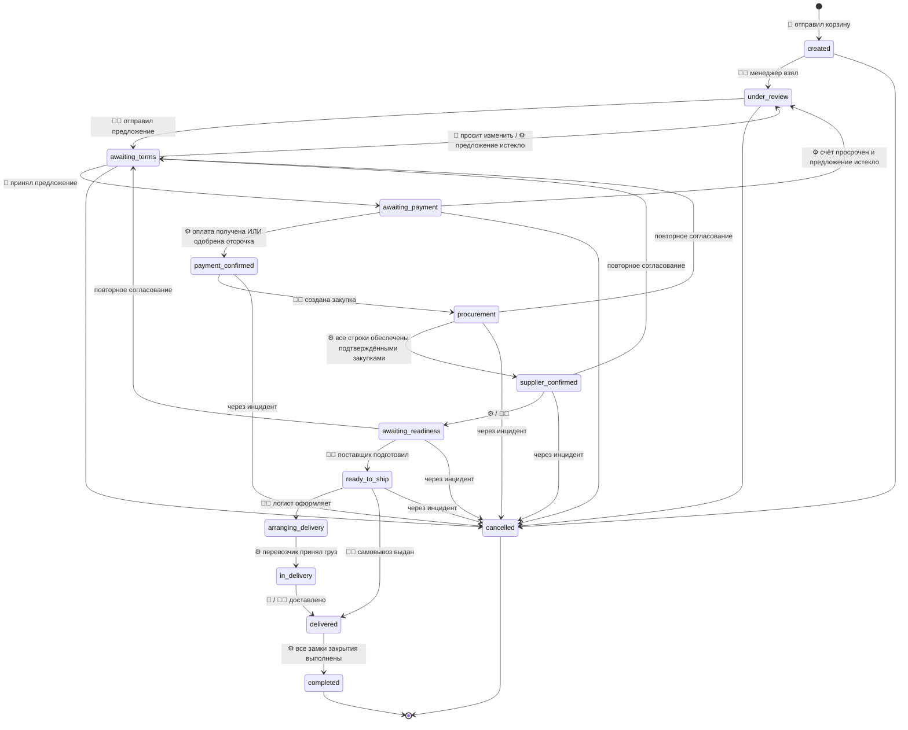
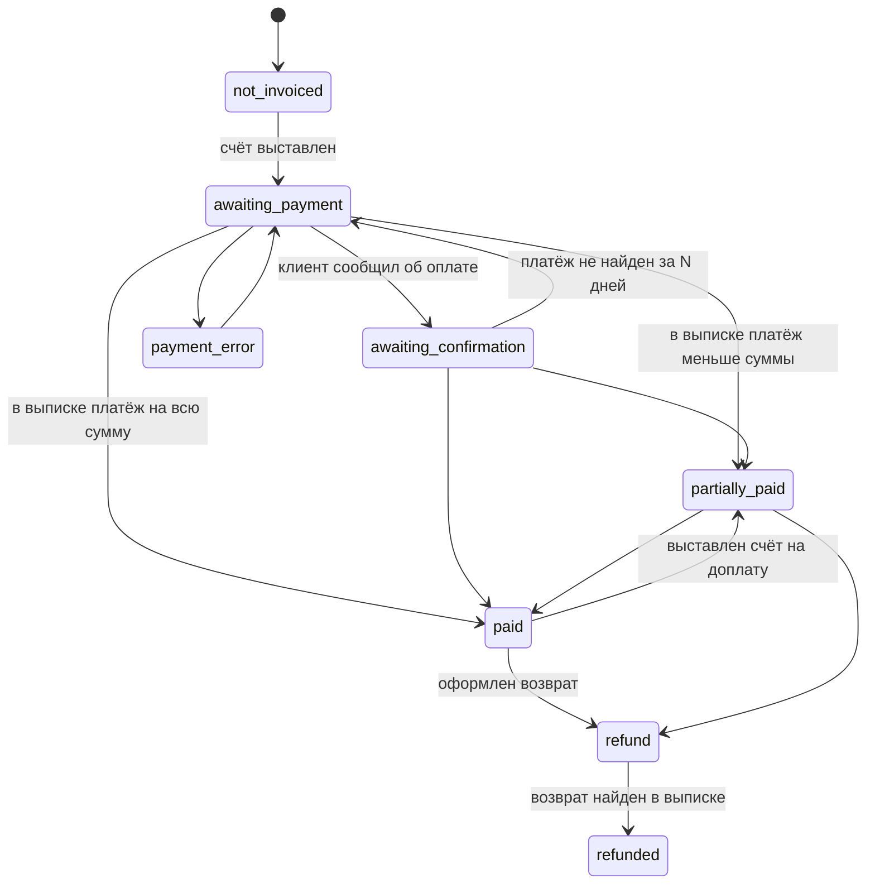
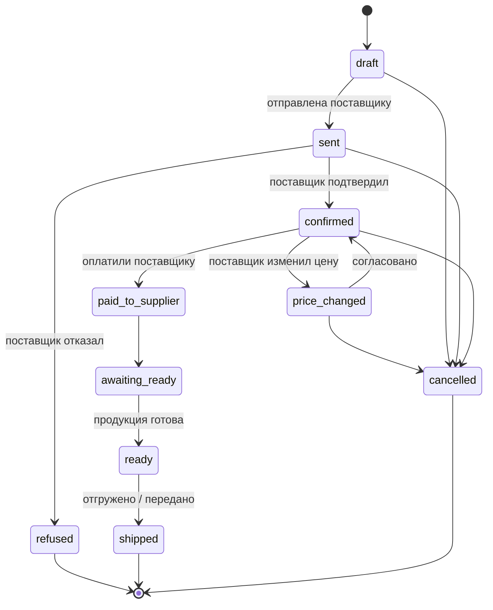
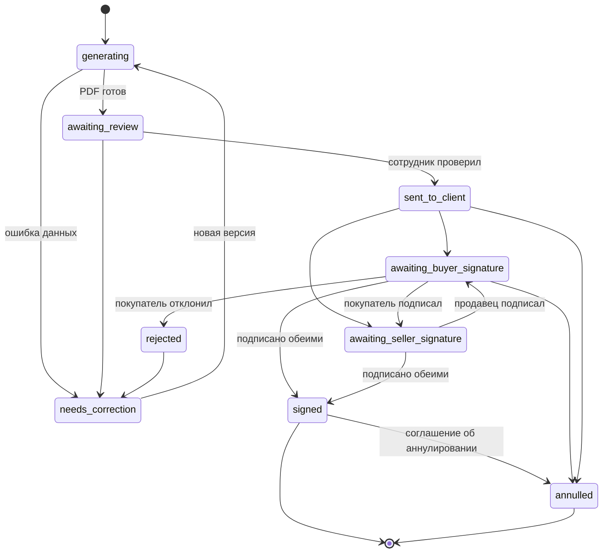
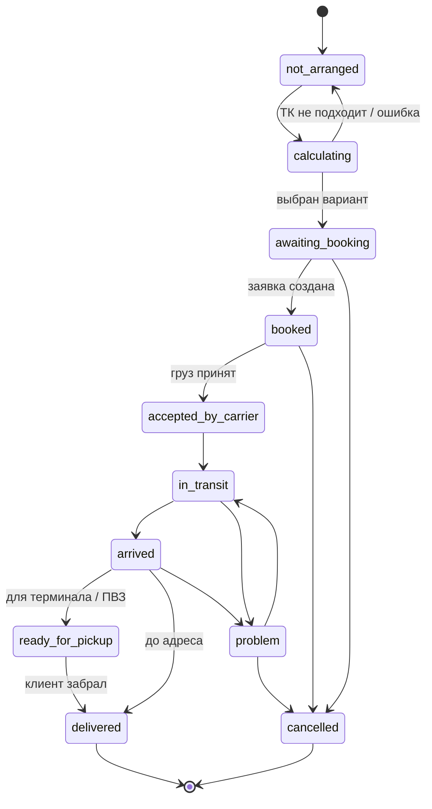

# 2. Статусы и правила переходов

Статус: черновик на согласование.

## Главное

У заказа **пять независимых линий статусов**: заказ, оплата, закупка, документы, доставка. Они идут параллельно. Например, заказ может быть оплачен, а закупка ещё не подтверждена, или договор ещё подписывается, а оплата уже пришла. Всё это нормальные ситуации.

Между линиями есть **«замки»**: переход в одной линии разрешён, только когда другая линия в нужном состоянии. Замки перечислены у каждого перехода.

Каждый переход записывается в историю: кто, когда, из какого статуса, в какой и почему (см. `status_history` в [схеме БД](01-baza-dannyh.md)).

Кто выполняет переход:

- 👤 **клиент** в приложении;
- 🧑‍💼 **сотрудник** в админке (роль указана);
- ⚙️ **система** автоматически;
- 🔌 **интеграция** (банк, ЭДО, ТК).

---

## 1. Статус заказа

| Код | Статус | Что видит клиент |
|---|---|---|
| `created` | Создан | «Заказ получен, менеджер скоро свяжется» |
| `under_review` | Проверяется менеджером | «Менеджер уточняет цену и сроки» |
| `awaiting_terms` | Ожидает подтверждения условий | «Проверьте и подтвердите условия» + кнопки |
| `awaiting_payment` | Ожидает оплаты | Счёт, реквизиты, сумма, срок |
| `payment_confirmed` | Оплата подтверждена | «Оплата получена, запускаем закупку» |
| `procurement` | Закупка у поставщика | «Заказ в работе» 💡 (слово «поставщик» клиенту не показываем, см. ниже) |
| `supplier_confirmed` | Поставщик подтвердил заказ | «Поставка подтверждена» + подтверждённый срок |
| `awaiting_readiness` | Ожидается готовность продукции | «Продукция готовится к отгрузке» |
| `ready_to_ship` | Продукция подготовлена к отгрузке | «Готово к отгрузке» / «Готово к самовывозу» |
| `arranging_delivery` | Организуется доставка | «Оформляем доставку» |
| `in_delivery` | Передан в доставку | Перевозчик, трек-номер, ссылка |
| `delivered` | Доставлен клиенту | «Получено» |
| `completed` | Завершён | «Заказ выполнен», кнопка «Повторить» |
| `cancelled` | Отменён | Причина |

💡 **Формулировки для клиента.** Внутренние статусы точные, а клиенту показываются нейтральные формулировки. Клиент не обязан разбираться во внутренней закупке, для него «Стилкор» — единственная точка контакта (требование ТЗ). Тексты для клиента настраиваются в админке.

### Подробности переходов и замки

| Переход | Кто | Замок (условие) | Что происходит |
|---|---|---|---|
| → `created` | 👤 | Организация клиента заполнена; регион активен | Уведомление менеджеру региона |
| `created` → `under_review` | 🧑‍💼 менеджер | — | Назначается ответственный |
| `under_review` → `awaiting_terms` | 🧑‍💼 менеджер | Есть предложение со статусом `sent`; у каждой товарной строки есть цена; маржа не ниже минимума **или** руководитель одобрил | Клиенту push и письмо с PDF предложения |
| `awaiting_terms` → `awaiting_payment` | 👤 «Принять условия» | Предложение не истекло (`valid_until`); реквизиты клиента `verified` | Предложение → `accepted` (неизменяемо). Создаётся счёт. По модели договора (О-2) создаётся договор или спецификация. Срок `agreed` записывается в `order_dates` |
| `awaiting_terms` → `under_review` | 👤 «Нужны изменения» или ⚙️ по истечении срока | — | Предложение → `rejected` или `expired` |
| `awaiting_payment` → `payment_confirmed` | ⚙️ | `payment_status` = `paid` **или** (`prepay_partial` и получен аванс) **или** одобрена отсрочка (`deferral_approved_by`, кредитный лимит не превышен). **Подписание документов не обязательно**, если компания так решит (💡 по умолчанию: договор или спецификация должны быть подписаны **или** оплата счёта признаётся акцептом — решает юрист, О-2) | Уведомление клиенту и закупщику |
| `payment_confirmed` → `procurement` | 🧑‍💼 закупщик | Есть хотя бы одна закупка, связанная с заказом | |
| `procurement` → `supplier_confirmed` | ⚙️ | Каждая товарная строка согласованного предложения полностью распределена на закупки в статусе `confirmed` или дальше | Срок `supplier_confirmed` в `order_dates` |
| `supplier_confirmed` → `awaiting_readiness` | ⚙️ | Сразу, если срок готовности в будущем | |
| `awaiting_readiness` → `ready_to_ship` | 🧑‍💼 закупщик | Все закупки по заказу в статусе `ready` | |
| `ready_to_ship` → `arranging_delivery` | 🧑‍💼 логист | Способ получения — доставка | Создаётся отправление |
| `ready_to_ship` → `delivered` | 🧑‍💼 логист | Самовывоз; отмечена выдача (кто получил, по какой доверенности) | |
| `arranging_delivery` → `in_delivery` | ⚙️ | Все отправления в статусе «Принята перевозчиком» или дальше | Клиенту трек-номер |
| `in_delivery` → `delivered` | 🔌 / 🧑‍💼 | Все отправления «Доставлена» | |
| `delivered` → `completed` | ⚙️ | Оплата `paid` (или отсрочка в пределах срока); закрывающие документы подписаны (О-17); нет открытых инцидентов | Кнопка «Повторить заказ» |

### Повторное согласование

Возникает, когда после оплаты поставщик меняет цену, срок, отказывает, или клиент сам хочет изменить заказ.

1. Сотрудник создаёт **инцидент** (`issues`) с причиной.
2. Заказ переходит в `awaiting_terms`, флаг `is_reagreement = true`. Закупка по затронутым строкам приостанавливается.
3. Менеджер готовит **новую версию предложения** с причиной. По модели договора готовится доп. соглашение или новая спецификация.
4. Клиент принимает или отказывается.
   - Принял, сумма выросла → выставляется счёт на доплату, `payment_status` = `partially_paid`, заказ ждёт доплаты (замок как в `awaiting_payment`).
   - Принял, сумма уменьшилась → создаётся возврат разницы или зачёт, **как предусмотрено договором** (О-13). Решение фиксирует сотрудник.
   - Отказался → отмена заказа через инцидент с возвратом.
5. После принятия заказ **возвращается** на этап, с которого ушёл (`procurement` и т. д.).

Ни один из шагов не меняет сумму клиента молча.

### Отмена

| Когда | Как |
|---|---|
| До оплаты (`created`…`awaiting_payment`) | Клиент или менеджер отменяет с причиной. Счёт аннулируется, неподписанные документы аннулируются |
| После оплаты, до закупки | Только через инцидент. Создаётся возврат |
| После закупки, до отгрузки | Только через инцидент типа `cancel_after_purchase`. Решение по возврату и удержаниям — **по договору**, принимает уполномоченный сотрудник, система только фиксирует |
| После передачи в доставку | Отмена недоступна; оформляется возврат товара как отдельный процесс (вне MVP) |

---

## 2. Статус оплаты

Статус оплаты **вычисляется системой** из привязанных платежей банка (`payment_allocations`). Сотрудник не может вручную поставить «Оплачен».

| Код | Статус | Правило |
|---|---|---|
| `not_invoiced` | Счёт не выставлен | 💡 добавлен к списку ТЗ: до принятия условий платить нечего |
| `awaiting_payment` | Ожидает оплаты | Есть выставленный счёт, привязанных платежей нет |
| `awaiting_confirmation` | Ожидает подтверждения поступления | Клиент нажал «Я оплатил» или загрузил платёжку. **Это только сигнал бухгалтерии, а не оплата** |
| `partially_paid` | Частично оплачен | 0 < сумма привязанных платежей < сумма счетов |
| `paid` | Оплачен | Сумма привязанных платежей ≥ сумма счетов |
| `refund` | Возврат средств | Есть возврат в статусе `approved` или `sent` |
| `refunded` | Возврат выполнен | 💡 добавлен: исходящий платёж найден в выписке |
| `payment_error` | Ошибка оплаты | Платёж вернулся банком, неверные реквизиты и т. п. |

**Источник правды — только выписка банка** (API банка или загруженный файл выписки). Квитанция клиента статус «Оплачен» не ставит никогда.

Как платёж привязывается к счёту — см. [интеграции](06-integracii.md), раздел «Банк».

---

## 3. Статус закупки

### 3.1. У каждого заказа поставщику (`purchase_orders.status`)

| Код | Статус | Комментарий |
|---|---|---|
| `draft` | Черновик | Закупщик собирает строки из оплаченных заказов |
| `sent` | Отправлена поставщику | |
| `confirmed` | Подтверждена поставщиком | Фиксируются цена, количество, срок готовности |
| `price_changed` | Цена изменена — нужно согласование | Автоматически создаётся инцидент по всем связанным заказам |
| `refused` | Отказ поставщика | Инцидент; строки нужно распределить на другого поставщика |
| `paid_to_supplier` | Оплачена поставщику | Финансово внутреннее, клиенту не видно |
| `awaiting_ready` | Ожидается готовность | |
| `ready` | Готово к отгрузке | |
| `shipped` | Получено / отгружено | |
| `cancelled` | Отменена | |

**Замок:** закупку можно отправить поставщику (`draft` → `sent`), только если **каждый** связанный клиентский заказ в статусе `payment_confirmed` или дальше. Исключение — одобренная отсрочка.

### 3.2. Сводно по заказу (`orders.procurement_status`)

| Код | Когда |
|---|---|
| `not_started` | Нет ни одной закупки |
| `in_progress` | Часть строк распределена или закупки не подтверждены |
| `confirmed` | Все строки обеспечены подтверждёнными закупками |
| `ready` | Все связанные закупки `ready` или дальше |
| `problem` | Есть закупка в `refused` или `price_changed` |
| `done` | Все связанные закупки `shipped` |

---

## 4. Статус документа

Свой статус у **каждого** документа: предложения, договора, спецификации, доп. соглашения, счёта, УПД.

| Код | Статус | Кто ставит |
|---|---|---|
| `generating` | Формируется | ⚙️ |
| `awaiting_review` | Ожидает проверки | ⚙️. 💡 На старте **все** документы проверяет сотрудник; позже для типовых можно включить автоотправку |
| `sent_to_client` | Отправлен клиенту | 🧑‍💼 или ⚙️ |
| `awaiting_buyer_signature` | Ожидает подписания покупателем | 🔌 ЭДО или 🧑‍💼 (бумажный путь) |
| `awaiting_seller_signature` | Ожидает подписания продавцом | 🔌 / 🧑‍💼 |
| `signed` | Подписан сторонами | 🔌 **только по данным оператора ЭДО** или 🧑‍💼 при получении бумажного оригинала со сканом |
| `rejected` | Отклонён | 🔌 / 🧑‍💼 с причиной |
| `needs_correction` | Требует исправления | 🧑‍💼 |
| `annulled` | Аннулирован | 🔌 / 🧑‍💼. Подписанный документ аннулируется **только** соглашением об аннулировании через ЭДО или на бумаге |

Порядок подписания (сначала продавец или покупатель) задаётся у вида документа (О-12).

Исправление подписанного документа невозможно: создаётся **новый** документ (доп. соглашение), старый остаётся.

### Отдельно: отправка, получение, подписание

Для каждого документа хранится раздельно:

| Факт | Где хранится |
|---|---|
| Отправлен по почте (кому, когда, статус письма) | `emails` |
| Отправлен в ЭДО, доставлен контрагенту | `edo_submissions` |
| Подписан покупателем / продавцом | `signatures` |

**Отправка PDF по почте не меняет статус документа на «Подписан».**

---

## 5. Статус доставки

### 5.1. У каждого отправления (`shipments.status`)

| Код | Статус |
|---|---|
| `not_arranged` | Не оформлена |
| `calculating` | Рассчитывается |
| `awaiting_booking` | Ожидает оформления |
| `booked` | Заказана |
| `accepted_by_carrier` | Принята перевозчиком |
| `in_transit` | В пути |
| `arrived` | Прибыла в пункт назначения |
| `ready_for_pickup` | Готова к выдаче |
| `delivered` | Доставлена |
| `problem` | Проблема с доставкой |
| `cancelled` | Отменена |

У СДЭК и Деловых Линий свои коды статусов. Каждый модуль перевозчика переводит их в наши (таблица соответствия — в модуле), а исходный код ТК сохраняется в `shipment_events`.

### 5.2. Сводно по заказу (`orders.delivery_status`)

Худший статус среди отправлений заказа: если хотя бы одно в `problem` — сводный `problem`; если все `delivered` — `delivered`.

---

## Проверочные сценарии

Пройдите их глазами — так проверяется, что модель отражает реальную работу.

### Сценарий 1. Обычный заказ, предоплата

| Шаг | Заказ | Оплата | Закупка | Документы | Доставка |
|---|---|---|---|---|---|
| Клиент отправил корзину | `created` | `not_invoiced` | `not_started` | — | `not_arranged` |
| Менеджер отправил предложение | `awaiting_terms` | `not_invoiced` | `not_started` | Предложение `sent_to_client` | |
| Клиент принял | `awaiting_payment` | `awaiting_payment` | | Счёт `sent_to_client`, спецификация `awaiting_buyer_signature` | |
| Пришли деньги (выписка) | `payment_confirmed` | `paid` | | Спецификация ещё подписывается — **это нормально** | |
| Закупщик отправил закупку | `procurement` | `paid` | `in_progress` | Спецификация `signed` | |
| Поставщик подтвердил | `supplier_confirmed` → `awaiting_readiness` | | `confirmed` | | |
| Готово | `ready_to_ship` | | `ready` | | |
| Логист заказал машину | `arranging_delivery` | | | | `booked` |
| Погрузили | `in_delivery` | | `done` | | `in_transit` |
| Привезли | `delivered` | | | УПД `awaiting_buyer_signature` | `delivered` |
| УПД подписан | `completed` | `paid` | `done` | все `signed` | `delivered` |

### Сценарий 2. Поставщик поднял цену после оплаты

1. Заказ `procurement`, оплата `paid`. Закупка → `price_changed`.
2. ⚙️ Создаётся инцидент; заказ → `awaiting_terms`, `is_reagreement = true`. Клиенту: «Изменились условия поставки, проверьте».
3. Менеджер ищет другого поставщика по старой цене? Если нашёл — инцидент закрыт без участия клиента, заказ возвращается в `procurement`.
4. Если нет — новая версия предложения (v2) с причиной + доп. соглашение. Клиент принимает → счёт на доплату, оплата `partially_paid` → после доплаты `paid` → заказ снова `procurement`.
5. Если клиент отказался → отмена через инцидент, возврат `refund` → `refunded` после исходящего платежа в выписке.

### Сценарий 3. Клиент на отсрочке

1. Клиент с одобренной отсрочкой 30 дней и лимитом 2 млн ₽ принимает предложение на 500 тыс. ₽.
2. Руководитель (или роль с правом) отмечает «Разрешить закупку до оплаты» с причиной → замок открыт: заказ → `payment_confirmed`, хотя оплата `awaiting_payment`.
3. Дальше обычный путь. Заказ не закрывается (`completed`), пока оплата не станет `paid`. При просрочке — уведомление менеджеру и бухгалтерии.
