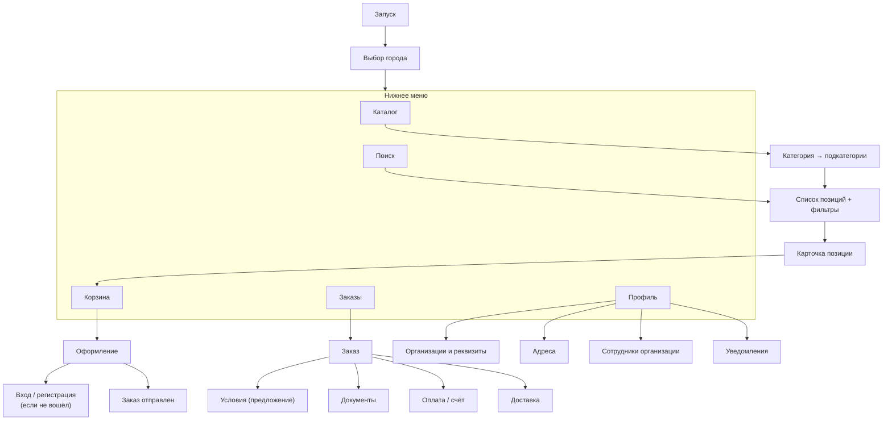

# 4. Карта экранов

Статус: черновик на согласование. Ориентир по удобству — Яндекс Еда, адаптированная под B2B.

## Мобильное приложение

### Экраны

| Экран | Что на нём | Действия |
|---|---|---|
| Выбор города | Список активных регионов | Выбрать; потом меняется в профиле |
| Каталог | Плитки категорий, строка поиска сверху | Перейти в категорию |
| Список позиций | Позиции, цена «от … за т» или «Цена по запросу», бейдж доступности; фильтры по характеристикам категории (марка, ГОСТ, диаметр, толщина, длина…); сортировка | Добавить в корзину прямо из списка |
| Карточка | Характеристики, ГОСТ, марка, цена и её дата актуальности, ориентировочный срок, статус доступности; калькулятор единиц (шт ↔ м ↔ кг ↔ т) | Количество + единица, комментарий («порезать по 3 м»), «В корзину» |
| Поиск | Строка с подсказками; понимает «круг 20 12х18н10т», «лист 4 ст3» | |
| Корзина | Позиции с количеством; предварительная сумма с пометкой «предварительно, менеджер подтвердит цену и срок»; позиции «по запросу» без суммы | Изменить, удалить, «Оформить» |
| Оформление (1 экран, как в Яндекс Еде) | Организация; получение: доставка (адрес) или самовывоз (пункт); желаемая дата и интервал; контакт на месте; комментарий | «Отправить заказ» |
| Заказы | Список с крупным статусом и иконками оплаты, документов, доставки | Фильтр: активные / завершённые |
| Заказ | Шкала этапов; блок «Нужно ваше действие» (принять условия, оплатить, подписать); состав; сроки (предварительный / согласованный / подтверждённый) | Повторить заказ, связаться с менеджером |
| Условия | Версия предложения, цены, итог, доставка, условия оплаты, срок действия (таймер); что изменилось относительно прошлой версии | «Принять», «Нужны изменения» (с комментарием), скачать PDF |
| Оплата | Счета, реквизиты, сумма, назначение платежа; статус по каждому счёту | Скачать PDF, поделиться, «Я оплатил» (сигнал бухгалтерии) |
| Документы | Список: вид, номер, статус подписания, где подписывается (ЭДО / бумага) | Просмотр PDF, скачать, перейти в ЭДО |
| Доставка | Перевозчик, трек-номер, события, ссылка на сайт ТК | |
| Организации | Добавление по ИНН (подсказка из DaData), статус проверки | Добавить, выбрать текущую |
| Сотрудники организации | Список и роли | Пригласить по телефону или почте (владелец) |
| Уведомления | Лента событий | Перейти к заказу |

## Админ-панель (Filament)

| Раздел | Содержимое |
|---|---|
| **Рабочий стол** | Мои задачи: новые заказы, истекающие предложения, неразобранные платежи, закупки без подтверждения, просроченные сроки, открытые инциденты |
| Заказы | Таблица с фильтрами по 5 статусам, региону, менеджеру. Карточка заказа: вкладки «Состав и предложения», «Себестоимость» (по правам), «Оплата», «Закупки», «Документы», «Доставка», «Сроки», «Инциденты», «История» |
| Конструктор предложения | Строки из запроса клиента → цена (подсказка из правил наценки и предложений поставщиков), себестоимость, маржа, срок действия, условия оплаты → PDF → «Отправить» |
| Клиенты | Организации, проверка реквизитов, пользователи, отсрочки, договоры |
| Каталог | Категории, характеристики, позиции, импорт из файла, цены и доступность по регионам |
| Поставщики | Карточки, предложения поставщиков (загрузка прайсов) |
| Закупки | Черновики из оплаченных заказов, распределение, статусы, документы поставщика |
| Финансы | Счета, выписки (загрузка), неразобранные платежи, возвраты |
| Документы | Все документы, статусы подписания, повторная отправка, история писем |
| Шаблоны | Шаблоны .docx с версиями и утверждением; реквизиты продавцов с версиями |
| Доставка | Отправления по всем заказам, расчёт у ТК, оформление, трекинг |
| Справочники | Регионы, пункты самовывоза, правила наценки |
| Администрирование | Сотрудники, роли, регионы доступа, журнал действий, журнал интеграций |
