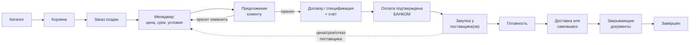

# Этап 2. Архитектура

Статус: **черновик на согласование** · 27.10.2026 · по решению от 27.10.2026 начата разработка MVP (`backend/`, `mobile/`).

Основа: [отчёт этапа 1](../01-analiz-i-arhitektura.md). Утверждённый стек: Laravel + Filament (сервер и админка), Expo / React Native (приложение), PostgreSQL, хостинг в РФ.

## Состав

| # | Документ | О чём | Кому полезно прочитать |
|---|---|---|---|
| 1 | [Схема базы данных](01-baza-dannyh.md) | Какие данные хранит система и как они связаны | Вам; ревьюеру |
| 2 | [Статусы и правила переходов](02-statusy.md) | Как заказ, оплата, закупка, документы и доставка движутся по этапам | Вам, руководству, менеджерам |
| 3 | [Роли и права](03-roli-i-prava.md) | Кто из сотрудников и клиентов что видит и может делать | Руководству, бухгалтерии |
| 4 | [Карта экранов](04-ekrany.md) | Экраны мобильного приложения и разделы админки | Вам, руководству |
| 5 | [Клиентский API](05-api.md) | Как приложение общается с сервером | Вам; ревьюеру |
| 6 | [Интеграции](06-integracii.md) | Банк, ЭДО, почта, доставка, каталог: общие интерфейсы и сценарии | Вам; ревьюеру |

## Главный сквозной сценарий

Пунктир — повторное согласование. Если поставщик изменил цену, срок или отказал, заказ **не меняется молча**: менеджер готовит новое предложение, клиент его принимает или отказывается.

## Соглашения во всех документах

- **Деньги** хранятся в рублях с копейками (`numeric(15,2)`), **количество** — с точностью до 4 знаков (`numeric(15,4)`), потому что тонны бывают дробными. Округление до копеек — построчно, правило согласует бухгалтерия (О-5).
- **Снимок (snapshot)**: в документах и согласованных предложениях хранится **копия** названия, марки, ГОСТа, цены и реквизитов на момент создания. Если потом поменять товар в каталоге или реквизиты, старые документы не изменятся.
- **Ничего не удаляется** из того, что связано с деньгами и документами: только «аннулирован» или «отменён» с причиной.
- **Каждая смена любого статуса** пишется в общую историю: кто (сотрудник, клиент, система, интеграция), когда, откуда, куда и почему.
- **Внутренние данные** (поставщики, закупочные цены, маржа) хранятся в **отдельных таблицах**. Клиентский API к ним не обращается вообще.
- Пометки: ❓ — зависит от ответа компании (номер вопроса О-N ниже), 💡 — моё предложение по умолчанию.

## Реестр открытых вопросов

Пока ответа нет, в проекте действует **значение по умолчанию** (последняя колонка). Оно выбрано так, чтобы потом его можно было поменять без переделки базы.

| № | Вопрос | Кому | Что от него зависит | По умолчанию 💡 |
|---|---|---|---|---|
| О-1 | Одно юрлицо продаёт во всех городах или в регионах свои ООО? | Руководство | Реквизиты в документах, нумерация, банк | Поддерживаем **несколько** юрлиц, у каждого региона своё. Если окажется одно — просто одна запись |
| О-2 | Модель договоров: разовый, рамочный + спецификации, работа по существующему | Руководство, юрист | Набор документов в заказе | Поддерживаем **все три**, тип выбирается у клиента |
| О-3 | Отсрочка платежа (на сайте «до 60 дней»): кому, в каких пределах? | Руководство, бухгалтерия | Можно ли закупать до оплаты | По умолчанию **100% предоплата**. Отсрочка — только при одобренном лимите клиента и ручном решении уполномоченного сотрудника |
| О-4 | Правила нумерации договоров, счетов, спецификаций | Бухгалтерия | Генерация номеров | Формат `{префикс}-{регион}-{год}-{порядковый}`, например `СЧ-SMR-2026-000123`, заказ — `ЗАК-SMR-2026-000123`. Счётчик свой у каждого юрлица и вида документа |
| О-5 | Налоговый режим, ставка НДС, правило округления | Бухгалтерия | Расчёт сумм | Ставка НДС хранится **в каждой строке**, значение по умолчанию задаётся в настройках юрлица |
| О-6 | Продажа по теоретической или фактической массе? | Бухгалтерия | Пересчёт единиц, итог в УПД | Цена в предложении — по теоретической массе. Фактическая фиксируется при отгрузке, разница — по правилу из договора |
| О-7 | Кто из сотрудников видит закупочные цены и маржу? | Руководство | Права | Только роли «Руководитель», «Закупщик», «Администратор» |
| О-8 | Какой оператор ЭДО уже используется? | Бухгалтерия | Интеграция ЭДО (этап 5) | Модуль ЭДО через общий интерфейс, оператор не зашит |
| О-9 | Откуда сайт берёт каталог и цены (1С, админка, Excel)? | Руководство, разработчик сайта | Импорт каталога | Импорт из файла (XLSX/CSV) с ручной загрузкой в админке |
| О-10 | Работаем ли с физлицами? | Руководство | Регистрация, оферта, 152-ФЗ, касса | Только **юрлица и ИП** в MVP. Тип «физлицо» в базе предусмотрен, но выключен |
| О-11 | Цены в городах разные? | Руководство | Прайс по регионам | Цена хранится **по региону** |
| О-12 | Кто подписывает первым: продавец или покупатель? | Юрист | Порядок ЭДО | Поддерживаем оба порядка, настройка у вида документа |
| О-13 | Условия отмены, возврата и удержаний | Юрист | Сценарии возвратов | Система только **фиксирует** решение сотрудника со ссылкой на пункт договора, сама ничего не удерживает |
| О-14 | Свой транспорт, наёмный или оба варианта? | Логистика | Способы доставки | Способ «Доставка компании» с ручной ценой от логиста |
| О-15 | Срок действия предложения (КП) по умолчанию | Руководство | Предложения | 3 рабочих дня, можно поменять в каждом предложении |
| О-16 | Закупкой занимается тот же менеджер или отдельный закупщик? | Руководство | Роли, интерфейс | Отдельная роль «Закупщик», но одному человеку можно дать обе роли |
| О-17 | Где формируются УПД и закрывающие документы (1С?) | Бухгалтерия | Документы, этап 4–5 | УПД формируются **в учётной системе компании** и загружаются или подтягиваются в заказ. Сами не генерируем, пока не решено иначе |
| О-18 | Откуда физически отгружается товар: от поставщика напрямую или через вашу площадку? | Логистика | Адрес отправления, самовывоз | Адрес отгрузки задаётся **у каждой закупки** (склад поставщика), может отличаться внутри одного заказа |

## Как проверить этот этап

Код ещё не пишется. Проверка — это чтение и вопросы:

1. Откройте [статусы](02-statusy.md) и пройдите глазами 3 сценария из раздела «Проверочные сценарии». Всё ли в них похоже на реальную работу компании?
2. Покажите [роли и права](03-roli-i-prava.md) руководителю: правильно ли распределено, кто что видит?
3. Откройте [карту экранов](04-ekrany.md) и представьте себя клиентом: хватает ли шагов, нет ли лишних?
4. Всё, что вызывает сомнение, пишите мне: поправлю документы до начала разработки.

Схемы (`mermaid`) отображаются картинками при просмотре файлов на GitHub.
